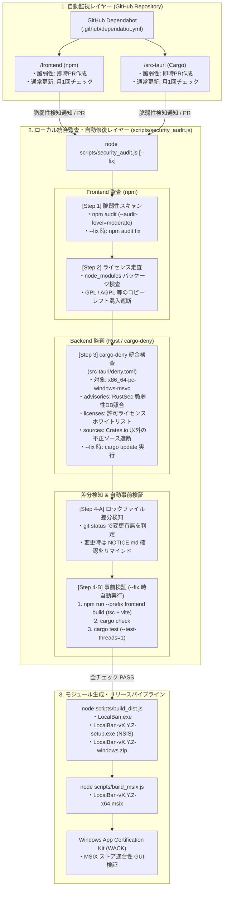

# CI/CD・脆弱性＆ライセンス監査パイプライン設計 (CI/CD & Security Audit Architecture)

「LocalBan」における依存ライブラリ（Frontend: npm / Backend: Rust Cargo）の脆弱性監視、ライセンス規約遵守、およびビルド・配布パッケージ生成までの CI/CD・リリース運用設計ドキュメントです。

個人開発（インディー開発）において**「完全無料（コストゼロ）」**かつ**「日常の運用負荷を最小化しつつ、脆弱性やライセンス違反を確実に防ぐ」**ことを目的に設計されています。

---

## 1. 全体パイプライン構成図



---

## 2. コア設計原則

1. **完全無料（OSS & GitHub標準機能のみ）**:
   - 有料の外部セキュリティSaaSに依存せず、GitHub標準の `Dependabot`、Node.js標準の `npm audit`、およびRustコミュニティ標準のOSSツール `cargo-deny`（MIT / Apache-2.0）のみで構成しています。
2. **「普段は放置・有事とリリース時のみ稼働」の省力運用**:
   - 日常的なマイナーアップデート通知による「PR疲れ（通知スパム）」を防ぐため、Dependabotの定期チェックは月1回（`monthly`）・最大5件までに制限しています。
   - 一方で、セキュリティ脆弱性（GitHub Security Advisories / RustSec）が発見された場合は、スケジュールに関わらず即座にDependabot Security Updatesが発火します。
3. **Windows ターゲット特化による誤検知（ノイズ）排除**:
   - Tauri v2 の `Cargo.lock` にはマルチプラットフォーム対応のため Linux 用クレート（`gtk`, `webkit2gtk`, `zbus` 等）も記録されます。
   - `src-tauri/deny.toml` で監査対象ターゲットを `x86_64-pc-windows-msvc` に限定することで、Windows バイナリに一切含まれない Linux 専用クレートの警告ノイズを完全に排除しています。
4. **脆弱性・ライセンス・サプライチェーンの三位一体防御**:
   - 単なる脆弱性（CVE / RustSec）だけでなく、個人・商用配布で問題となる「GPL/AGPL等の強いコピーレフトライセンスの意図せぬ混入」や「Crates.io以外の不明なGitリポジトリからの依存取得」も機械的にブロックします。

---

## 3. コンポーネント別設計仕様

### 3.1 GitHub 自動監視設定 (`.github/dependabot.yml`)

| 対象エコシステム | 監視ディレクトリ | 定期スケジュール | PR上限数 | 備考 |
| :--- | :--- | :--- | :--- | :--- |
| `npm` | `/frontend` | `monthly`（月1回） | 5 | フロントエンド（React / Vite / CodeMirror / Tailwind 等）を監視 |
| `cargo` | `/src-tauri` | `monthly`（月1回） | 5 | バックエンド（Tauri / rusqlite / zip / serde 等）を監視 |

### 3.2 Rust 監査設定 (`src-tauri/deny.toml`)

`cargo-deny` を用いて、以下の3つの観点で `src-tauri/Cargo.lock` を検査します。

| セクション | 検査内容 | 設定ポリシー |
| :--- | :--- | :--- |
| `[graph]` | 依存ツリー解決条件 | `targets = [{ triple = "x86_64-pc-windows-msvc" }]` を指定し、Windows 実ビルド対象のみを解析。 |
| `[advisories]` | 既知の脆弱性 (RustSec) | 脆弱性（`vulnerability`）が1件でも存在する場合はエラー（Exit Code 1）として検出。 |
| `[licenses]` | ライセンス互換性 | `MIT`, `Apache-2.0`, `BSD-2-Clause`, `BSD-3-Clause`, `0BSD`, `ISC`, `Unicode-3.0`, `Zlib`, `MPL-2.0`, `Unlicense`, `CC0-1.0` のみをホワイトリスト許可。未許可ライセンス混入時は即エラー。 |
| `[sources]` | 取得元レジストリ検証 | `unknown-registry = "deny"`, `unknown-git = "deny"` により、公式 `crates.io-index` 以外の外部ソース混入を禁止。 |

### 3.3 ローカル統合監査・自動修復スクリプト (`scripts/security_audit.js`)

開発者がコマンド1つでフロントエンド・バックエンド双方の点検と修復を行える Node.js スクリプトです。

| 実行モード | コマンド | 動作内容 |
| :--- | :--- | :--- |
| **監査モード (Check)** | `node scripts/security_audit.js` | ファイルを書き換えず、以下の4ステップを実行（所要時間：約4〜5秒）：<br>1. `npm audit --audit-level=moderate`<br>2. `frontend/node_modules` 内のコピーレフトライセンス検査<br>3. `cargo deny check advisories licenses sources`<br>4. マニフェスト・ロックファイルの変更有無確認 |
| **修復＆検証モード (Fix)** | `node scripts/security_audit.js --fix` | 上記の監査に加え、互換パッチの自動適用とビルド・単体テストまでを一括実行：<br>1. `npm audit fix` の実行<br>2. `cargo update` の実行<br>3. 再監査の実行と `NOTICE.md` 更新要否のリマインド表示<br>4. フロントエンド型チェック＆ビルド（`npm run --prefix frontend build`）<br>5. Rust コンパイルチェック（`cargo check`）＆単体テスト（`cargo test -- --test-threads=1`） |

---

## 4. 脆弱性検知時の標準対応ワークフロー

脆弱性が発見された場合、以下のフローに従って対処します。

### ケースA：互換範囲内で自動修復できる場合（通常ケース）
1. `node scripts/security_audit.js --fix` を実行する。
2. ロックファイル（`package-lock.json` / `Cargo.lock`）が自動更新され、フロントエンドビルドおよび Rust 単体テストがすべて PASS することを確認する。

### ケースB：間接依存（孫パッケージ）の脆弱性で親ライブラリが未対応の場合
親ライブラリが古いバージョンに依存し続けており、通常の `npm audit fix` や `cargo update` では解消できない場合は、以下の強制オーバーライド機能を使用する。

- **Frontend (npm) の場合**:
  `frontend/package.json` に `"overrides"` フィールドを追加し、孫パッケージの安全なバージョンを直接指定する。
  ```json
  "overrides": {
    "対象パッケージ名": "^安全なバージョン"
  }
  ```
- **Backend (Rust) の場合**:
  - 特定クレートのみの更新: `cargo update --manifest-path src-tauri/Cargo.toml -p <crate_name>`
  - メジャーバージョンアップが必要な場合: `src-tauri/Cargo.toml` のバージョン指定を引き上げるか、`[patch.crates-io]` を使用する。
  - Windows 環境で該当コードパスを一切使用しておらず、実害がないことが確実な場合の例外措置: `src-tauri/deny.toml` の `[advisories] ignore` に理由コメント付きで Advisory ID を記載する。

### ケースC：ライセンス・著作権表示（`NOTICE.md`）の更新確認
- ライブラリの追加・削除・メジャー更新があった場合は、ルート直下の `NOTICE.md`（配布 ZIP にも同梱）の著作権表示・ライセンス条項に差分がないか確認し、必要に応じて更新する。

### ケースD：配布モジュール（リリースバイナリ）への反映
- 既に公開・配布しているバイナリ（`LocalBan.exe` / `.msix`）のセキュリティに影響する修正を行った場合は、パッチバージョン（`vX.Y.Z`）をインクリメントし、以下のスクリプトで配布物を再生成する。
  ```powershell
  node scripts/build_dist.js
  node scripts/build_msix.js
  ```
