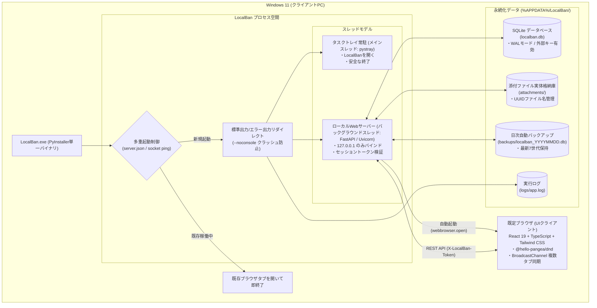

# システム全体概要 (System Architecture)

「LocalBan」は、Windows 11 上で単一の実行可能ファイル（`.exe`）として動作する個人用オフラインカンバンボードです。  
外部通信を行わない完全オフライン設計であり、ローカルサーバーとモダンなWebフロントエンドが協調して動作します。

---

## 1. アーキテクチャ構成図

---

## 2. コア設計原則

1. **完全ゼロ設定 & ポータブル**:
   - インストーラーや事前設定は不要。`LocalBan.exe` を実行するだけで `%APPDATA%/LocalBan` 配下にデータベースやフォルダが自動初期化され、ブラウザが起動します。
2. **完全オフライン動作**:
   - 外部CDN、Google Fonts、外部テレメトリ送信等は一切排除。全CSS・JavaScript・アイコン（`lucide-react`）・フォントが単一exe内にバンドルされています。
3. **安全な2段階削除フロー**:
   - カンバン画面からは「アーカイブ」のみ可能（誤操作によるデータ喪失を防止）。
   - リスト削除時も所属カードは自動的にアーカイブに退避されます。
   - 「アーカイブ一覧」モーダルから明示的に操作した場合のみ、DBレコードおよびディスク上の添付ファイルが物理削除されます。
4. **使いやすい終了フロー**:
   - タスクトレイアイコンの右クリックメニュー「終了」と、Web画面右上の「電源（終了）」ボタンの両方に対応。

---

## 3. セキュリティ設計

| 脅威 / リスク | 対策実装 |
|---|---|
| **ローカルAPIへの外部CSRF / DNS Rebinding** | ・`127.0.0.1` にのみバインド（`0.0.0.0` は禁止）。 ・FastAPI ミドルウェアで `Host` ヘッダー（`127.0.0.1`, `localhost`）を検証。 ・書き込みリクエストで `Origin` ヘッダーを検証。 ・サーバー起動時に一意なランダムトークン（`SESSION_TOKEN`）を生成し、全 `/api/*` リクエストで `X-LocalBan-Token` ヘッダーを厳格検証。 |
| **添付ファイル経由の XSS** | ・ディスク保存ファイル名は `uuid4().hex` とし、ユーザー指定のファイル名はパスに使用しない。 ・レスポンスに `X-Content-Type-Options: nosniff` および `X-Frame-Options: DENY` を付与。 ・SVG や HTML 等のスクリプト実行リスクのあるファイルは強制ダウンロード（`Content-Disposition: attachment`）として配信。 |
| **パストラバーサル攻撃** | ・ダウンロードおよび削除処理時、対象パスが専用ディレクトリ配下にあるかを `path.resolve().is_relative_to(attachments_dir)` で検証。 |
| **Markdown 説明文の XSS** | ・`react-markdown` で生HTML解釈（`rehype-raw`）を無効化。 ・リンクスキームを `http:` / `https:` に限定し、`target="_blank" rel="noopener noreferrer"` を強制。 |
| **過大ファイルアップロード** | ・1ファイルあたり最大50MBの容量上限を設定（超過時は即座に 413 エラー）。 |
| **本番APIエンドポイントの露出** | ・PyInstaller 実行時（本番バイナリ）は `/docs`, `/redoc`, `/openapi.json` を非公開化。 |

---

## 4. プロセス＆ライフサイクル制御

### (1) 起動フロー
1. `LocalBan.exe` をダブルクリックして起動。
2. `init_logging_redirect()` により、Windows GUIモード（`--noconsole`）時の `sys.stdout` / `sys.stderr` を `%APPDATA%/LocalBan/logs/app.log` へリダイレクト（Uvicornクラッシュ防止）。
3. `%APPDATA%/LocalBan/server.json` の存在とポート疎通をチェック：
   - 既存サーバーが応答した場合：そのURLをブラウザで開いて自プロセスは即終了（二重起動防止）。
   - 存在しない、または応答がない場合：空きポート（デフォルト8000〜）を探索してバインド。
4. Uvicorn サーバーをバックグラウンドスレッドで起動。
5. ブラウザを自動起動（`http://127.0.0.1:{PORT}/?token={TOKEN}`）。
6. メインスレッドで `pystray` トレイアイコンを開始。

### (2) 終了フロー
- **Web UIからの終了**:
  - 右上の電源ボタン → 確認ダイアログ → `/api/system/shutdown` 呼び出し。
  - サーバー停止コールバックが発火し、Uvicorn の `should_exit = True` を設定してトレイアイコンを停止、完全終了。
- **タスクトレイからの終了**:
  - トレイアイコン右クリック →「終了」→ `server.should_exit = True` を設定し、`server.json` をクリーンアップして終了。

### (3) アンインストールフロー（セキュリティ・データ保護設計）
- **Web UI / API からのアンインストール排除**:
  - Web画面やバックエンドAPIにはアンインストール用エンドポイントを一切配置しません。これにより、悪意ある外部WebページからのCSRF攻撃や誤操作による全データ損失を根本から防止します。
- **同梱の `uninstall.bat` によるローカル操作**:
  - 配布ZIP内に同梱された `uninstall.bat` を実行。
  - Windows ネイティブの GUI 確認ダイアログ（PowerShell MessageBox）による二重確認。
  - 実行中の `LocalBan.exe` プロセスを自動停止。
  - `%APPDATA%/LocalBan/` の永続化データ（DB、添付ファイル、バックアップ、ログ等）を完全削除。
  - 展開先フォルダ内の本体ファイル（`LocalBan.exe`）を削除し、完了ダイアログを表示。

---

## 5. フロントエンド・リアルタイム同期機能

- **複数ブラウザタブ間の同期**:
  - Web標準の `BroadcastChannel('localban_sync')` を使用。
  - いずれかのタブでカードの移動、編集、削除、アーカイブ等の操作が行われた際、全タブに変更イベントを同報。別タブの画面がリロード不要で自動最新化されます。
- **リアルタイム保存状態インジケーター**:
  - API通信ライフサイクルと連動し、ヘッダーに「✓ 保存済み」「⟳ 保存中...」「⚠ 保存エラー」を常時表示。
