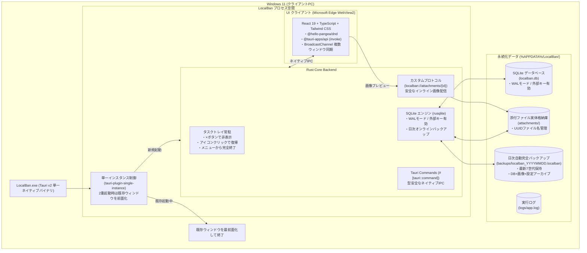

# システム全体概要 (System Architecture) - v2.0.0

「LocalBan」は、Windows 11 上で単一の実行可能ファイル（`LocalBan.exe`）として動作する個人用オフラインカンバンボードです。  
**Tauri v2 (Full Rust)** を採用し、超軽量・高速な Rust コアバックエンドと、Microsoft Edge WebView2 によるモダンな UI フロントエンドが型安全なネイティブ IPC で協調動作します。

---

## 1. アーキテクチャ構成図

---

## 2. コア設計原則

1. **完全ゼロ設定 & ポータブル**:
   - インストーラーや外部ランタイム（Python等）の事前導入は一切不要。`LocalBan.exe` 単体をダブルクリックするだけで `%APPDATA%/LocalBan` 配下にデータベースやフォルダが自動初期化され、独立したウィンドウが起動します。
2. **完全オフライン & ネイティブ完結**:
   - 外部通信、CDN、テレメトリ送信等は一切行いません。
   - バックエンド処理はすべて Rust でネイティブコンパイルされており、起動時間の大幅な短縮と省メモリ（数十MB程度）を実現しています。
3. **常駐型クライアントアプリ (パターン2)**:
   - ウィンドウ右上の「×（閉じる）」ボタンを押すとタスクトレイに格納され、トレイアイコンのクリックや `LocalBan.exe` の再起動で一瞬で復帰します。
   - アプリの完全終了は画面右上の「終了」ボタン、またはタスクトレイメニューの「終了」から安全に行えます。
4. **安全な2段階削除フロー**:
   - 通常画面からは「アーカイブ」のみ可能（誤操作によるデータ喪失を防止）。
   - リスト削除時も所属カードは自動的にアーカイブに退避されます。
   - 「アーカイブ一覧」モーダルから明示的に操作した場合のみ、DBレコードおよびディスク上の添付ファイルが物理削除されます。

---

## 3. セキュリティ設計

| 脅威 / リスク | 対策実装 |
|---|---|
| **外部ネットワークからの不正アクセス / CSRF** | ・外部ポートをリッスンする HTTP サーバーを持たず、OS の安全なネイティブ IPC チャネル（Tauri Commands）経由で通信。 ・外部ブラウザや悪意あるサイトからの直接 API 呼び出しが物理的に不可能。 |
| **添付ファイル経由の XSS** | ・ディスク保存ファイル名は `uuid4().simple` とし、ユーザー指定ファイル名はパスに使用しない。 ・カスタムプロトコル（`localban://`）配信時に `X-Content-Type-Options: nosniff` を付与。 ・SVG や HTML 等のスクリプト実行リスクのあるファイルはインライン表示を拒否し、強制ダウンロード扱いとする。 |
| **パストラバーサル攻撃** | ・添付ファイルの解決時、ファイル名のみを抽出し、`attachments` ディレクトリ配下であることを `safe_resolve_attachment_path` で厳格に検証。 |
| **Markdown 説明文の XSS** | ・`react-markdown` で生HTML解釈（`rehype-raw`）を無効化。 ・リンククリック時は `@tauri-apps/plugin-opener` を使用して OS 既定のブラウザで安全に開く。 |
| **過大ファイルアップロード** | ・添付ファイルアップロード時に最大50MBの容量上限を Rust コア層で検証（超過時は即座にエラー拒否）。 |

---

## 4. プロセス＆ライフサイクル制御

### (1) 起動フロー
1. `LocalBan.exe` をダブルクリックして起動。
2. `tauri-plugin-single-instance` により、同一プロセスの起動有無をチェック：
   - 既に起動している場合：既存ウィンドウを `show()` + `unminimize()` + `set_focus()` で最前面に復帰させ、新プロセスは即時終了。
   - 新規起動の場合：`%APPDATA%/LocalBan` の各フォルダを作成し、SQLite スキーマ初期化および日次完全バックアップ（画像含む）を実行。
3. 独立したデスクトップクライアントウィンドウ（Edge WebView2）を生成・表示。
4. Windows タスクトレイ（通知領域）に「LocalBan」アイコンを常駐。

### (2) 最小化・トレイ格納フロー
- ウィンドウ右上の「×（閉じる）」ボタンが押された場合：
  - `WindowEvent::CloseRequested` イベントをフックし、`api.prevent_close()` でプロセス終了をキャンセル。
  - ウィンドウを `hide()` してタスクトレイに格納。

### (3) 終了フロー
- **画面からの終了**:
  - 右上の「終了」ボタン → 確認ダイアログ → `shutdown_app` コマンド呼び出し。
  - `app_handle.exit(0)` によりプロセスを完全終了。
- **タスクトレイからの終了**:
  - トレイアイコン右クリック →「終了」メニュー選択 → `app.exit(0)` により完全終了。

### (4) アンインストールフロー（セキュリティ・データ保護設計）
- **画面内からのアンインストール操作排除**:
  - 誤操作による全データ損失を防止するため、画面内にアンインストールボタンは配置しません。
- **同梱の `uninstall.bat` によるローカル操作**:
  - 配布ZIP内に同梱された `uninstall.bat` を実行。
  - Windows ネイティブの GUI 確認ダイアログ（PowerShell MessageBox）による二重確認。
  - 実行中の `LocalBan.exe` プロセスを自動停止。
  - `%APPDATA%/LocalBan/` の永続化データ（DB、添付ファイル、バックアップ、ログ等）を完全削除。
  - 展開先フォルダ内の本体ファイル（`LocalBan.exe`）を削除し、完了ダイアログを表示。
