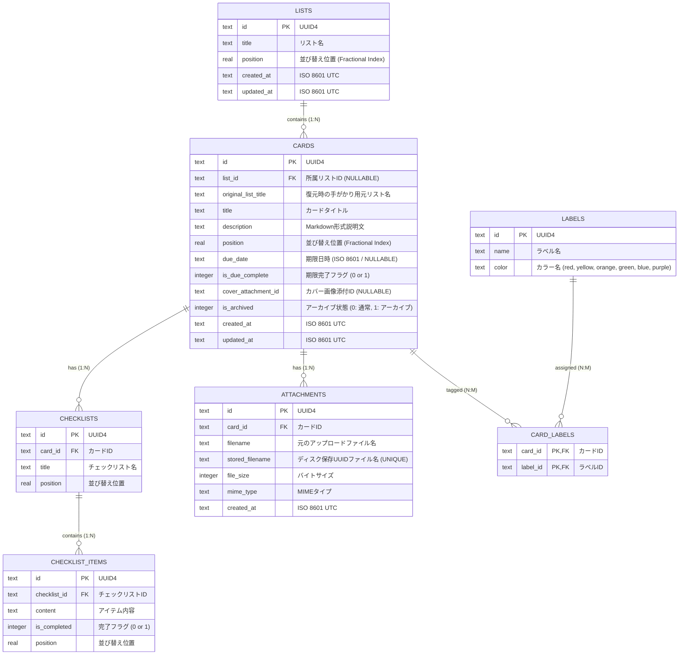

# データスキーマ設計 (Database Schema Design)

LocalBan のデータはすべてローカルの SQLite データベースファイル（`%APPDATA%/LocalBan/localban.db`）に永続化されます。  
並行処理時のパフォーマンス向上とデータ整合性維持のため、WAL（Write-Ahead Logging）モードおよび外部キー制約を強制有効化しています。  
（※ v2.0.0 より Rust の `rusqlite` クレートによる直接接続・管理へ刷新され、v1.x と 100% 互換のスキーマでそのままデータを引き継ぎます）

---

## 1. 接続設定・PRAGMA

データベース接続オープン時に、すべてのコネクションで以下の PRAGMA を必ず実行します：

```sql
PRAGMA journal_mode = WAL;
PRAGMA foreign_keys = ON;
```

- **`journal_mode = WAL`**: 読み取りと書き込みの並行性を確保し、UI操作時のブロッキングを防止。
- **`foreign_keys = ON`**: カスケード削除や参照整合性を保証（SQLite のデフォルトは無効のため明示設定）。
- **`user_version`**: スキーマバージョン（現行: `1`）を保持し、将来のマイグレーションに備える。

---

## 2. ER図 (Entity-Relationship Diagram)



---

## 3. テーブル定義詳細

### (1) `lists` (カンバンリスト)
水平スクロールのカンバンリストを管理します。

| カラム名 | 型 | 制約 | 説明 |
|---|---|---|---|
| `id` | TEXT | PRIMARY KEY | UUID (v4) |
| `title` | TEXT | NOT NULL | リスト名（例: ToDo, 進行中, 完了） |
| `position` | REAL | NOT NULL | 並び順を表す浮動小数点数（1000.0, 2000.0...） |
| `created_at` | TEXT | NOT NULL | 作成日時 (ISO 8601 UTC) |
| `updated_at` | TEXT | NOT NULL | 更新日時 (ISO 8601 UTC) |

### (2) `cards` (カード)
タスクの詳細情報を管理します。

| カラム名 | 型 | 制約 | 説明 |
|---|---|---|---|
| `id` | TEXT | PRIMARY KEY | UUID (v4) |
| `list_id` | TEXT | REFERENCES lists(id) ON DELETE SET NULL | 所属リストID。リスト削除時は `NULL` になりカードはアーカイブへ退避 |
| `original_list_title`| TEXT | NULLABLE | リスト削除時に退避された元のリスト名（復元時の手がかり） |
| `title` | TEXT | NOT NULL | カード名 |
| `description` | TEXT | NOT NULL DEFAULT '' | GFM準拠のMarkdown説明文 |
| `position` | REAL | NOT NULL | 並び順を表す浮動小数点数 |
| `due_date` | TEXT | NULLABLE | 期限日時 (ISO 8601) |
| `is_due_complete` | INTEGER | NOT NULL DEFAULT 0 | 期限の完了チェック (0: 未完了, 1: 完了) |
| `cover_attachment_id`| TEXT | NULLABLE | カンバンカード上部に表示するカバー画像の添付ファイルID |
| `is_archived` | INTEGER | NOT NULL DEFAULT 0 | 0: ボードに表示, 1: アーカイブ済み（ボードから非表示） |
| `created_at` | TEXT | NOT NULL | 作成日時 (ISO 8601 UTC) |
| `updated_at` | TEXT | NOT NULL | 更新日時 (ISO 8601 UTC) |

### (3) `labels` (タグ・ラベル)
カードに付与できるカラーラベルです。

| カラム名 | 型 | 制約 | 説明 |
|---|---|---|---|
| `id` | TEXT | PRIMARY KEY | UUID (v4) |
| `name` | TEXT | NOT NULL | ラベル表示名（例: 優先度: 高） |
| `color` | TEXT | NOT NULL | カラーコード/キーワード (`red`, `yellow`, `orange`, `green`, `blue`, `purple`) |

### (4) `card_labels` (カード・ラベル中間テーブル)
カードとラベルの多対多関係を保持します。

| カラム名 | 型 | 制約 | 説明 |
|---|---|---|---|
| `card_id` | TEXT | REFERENCES cards(id) ON DELETE CASCADE | カードID |
| `label_id` | TEXT | REFERENCES labels(id) ON DELETE CASCADE | ラベルID |
| - | - | PRIMARY KEY (`card_id`, `label_id`) | 複合主キー |

### (5) `checklists` (チェックリスト親)
カード内に複数作成できるチェックリストです。

| カラム名 | 型 | 制約 | 説明 |
|---|---|---|---|
| `id` | TEXT | PRIMARY KEY | UUID (v4) |
| `card_id` | TEXT | REFERENCES cards(id) ON DELETE CASCADE | 所属カードID |
| `title` | TEXT | NOT NULL DEFAULT 'チェックリスト' | チェックリスト名 |
| `position` | REAL | NOT NULL | 並び替え順 |

### (6) `checklist_items` (チェックリスト項目)
チェックリスト内の個々のタスク項目です。

| カラム名 | 型 | 制約 | 説明 |
|---|---|---|---|
| `id` | TEXT | PRIMARY KEY | UUID (v4) |
| `checklist_id` | TEXT | REFERENCES checklists(id) ON DELETE CASCADE | 所属チェックリストID |
| `content` | TEXT | NOT NULL | 項目内容 |
| `is_completed` | INTEGER | NOT NULL DEFAULT 0 | 完了チェック (0: 未完了, 1: 完了) |
| `position` | REAL | NOT NULL | 並び替え順 |

### (7) `attachments` (添付ファイルメタデータ)
アップロードされた画像やファイルのメタデータを記録します。実体ファイルは `%APPDATA%/LocalBan/attachments/{stored_filename}` に保存されます。

| カラム名 | 型 | 制約 | 説明 |
|---|---|---|---|
| `id` | TEXT | PRIMARY KEY | UUID (v4) |
| `card_id` | TEXT | REFERENCES cards(id) ON DELETE CASCADE | 所属カードID |
| `filename` | TEXT | NOT NULL | ユーザーがアップロードした元のファイル名 |
| `stored_filename` | TEXT | NOT NULL UNIQUE | ディスク上に保存されるUUIDファイル名（例: `5f8a...3b.png`） |
| `file_size` | INTEGER | NOT NULL | ファイルサイズ（バイト） |
| `mime_type` | TEXT | NULLABLE | MIMEタイプ（例: `image/png`, `application/pdf`） |
| `created_at` | TEXT | NOT NULL | アップロード日時 (ISO 8601 UTC) |

---

## 4. 特殊なデータ整合性ロジック

### (1) リスト削除時のカード自動アーカイブ保護
- 「通常画面から直接カードを削除することはできない」という制約を遵守するため、リスト削除時は外部キーによるカスケード物理削除を**行いません**。
- 所属カードを `is_archived = 1`, `list_id = NULL`, `original_list_title = リスト名` に一括更新してからリストを削除します。

### (2) 2段階完全削除のトランザクション整合性
- アーカイブカードの「完全に削除」操作時：
  1. DB トランザクション内でカードを削除（カスケード制約により `card_labels`, `checklists`, `checklist_items`, `attachments` レコードも自動削除）し、コミット。
  2. コミット成功後、紐付いていた実体ファイル（`stored_filename`）をディスクから削除。
  3. 万が一ファイル削除時に障害が発生しても、起動時の `cleanup_orphaned_attachments()` がDBに存在しない孤立ファイルを自動検出して掃除します。

### (3) Fractional Indexing と自動リバランス
- ドラッグ移動時は前後の平均値 `(prev + next) / 2` を position に設定。
- 連続操作により隣接カードとの position 差分が `1e-4` 未満に狭まった場合、バックエンドが該当リスト内のカード position を 1000 刻み（1000, 2000, 3000...）に自動再計算して精度枯渇を防ぎます。

### (4) 日次自動バックアップ
- サーバー起動時、当日のバックアップ（`%APPDATA%/LocalBan/backups/localban_YYYYMMDD.db`）が存在しない場合、SQLite Online Backup API を使用して安全に複製を作成します。
- 直近7世代を超過した古いバックアップファイルは自動的にローテーション削除されます。
